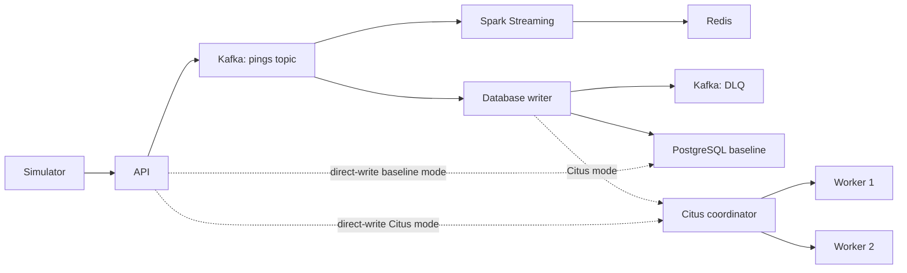
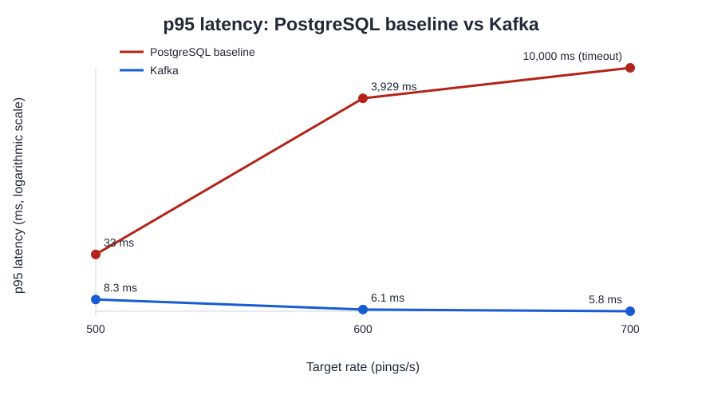

# GeoPulse

GeoPulse is a real-time vehicle-tracking data platform designed to simulate up to 10,000 vehicles
(~600k pings/min); Kafka ingestion has been tested at up to 700 pings/s. It runs locally on Kubernetes
with Spark Structured Streaming live statistics and sharded PostgreSQL (Citus) storage.

## Architecture



The API defaults to direct PostgreSQL writes; after deploying Kafka, enable it with
`.\infra\kubernetes\phase1\deploy.ps1 -IngestionMode kafka`. The Citus setup also
supports Kafka ingestion through a separate [mode switch](docs/engineering-notes.md#phase-4-sharding-with-citus).
See the [Kafka](docs/engineering-notes.md#phase-2-kafka) and
[Citus](docs/engineering-notes.md#phase-4-sharding-with-citus) notes.

## Key results

| Test | Result |
|---|---|
| Direct PostgreSQL baseline | Breaks at ~500 pings/s: p95 33 ms at 500/s, 3,929 ms at 600/s, and timeouts at 700/s. |
| Kafka ingestion (highest rate tested) | At 500/600/700 pings/s, p95 was 8.3/6.1/5.8 ms, with zero failed requests. |
| Writer outage | 120 pings were acknowledged while the writer was stopped; all were stored exactly once after restart, with 5.21 s catch-up. |



These are single local runs on one laptop, not production capacity claims.
The [baseline](docs/engineering-notes.md#phase-1-baseline-where-it-breaks-in-kubernetes)
and [Kafka comparison](docs/engineering-notes.md#kafka-comparison-november-21-2026) were not controlled like-for-like experiments.

## Key engineering findings

- The API process was the bottleneck at about one CPU core, not PostgreSQL at
  about 0.13 core.
- Timed-out requests can still be stored; retries can create duplicates. Vehicle
  sequence numbers and idempotent inserts address this at the database.
- Kafka decouples ingestion from database writes and can buffer pings during a
  writer outage; the small recovery test is not a guarantee for every failure.

## Roadmap

| Phase | What | Status |
|---|---|---|
| 0 | Kubernetes and monitoring | Done |
| 1 | Simulator, API, PostgreSQL baseline | Done |
| 2 | Kafka ingestion and database writer | Done |
| 3 | Streaming area statistics and dashboard | Done |
| 4 | Citus sharding and migration | Done |
| 5 | Backlog-based autoscaling and infrastructure as code | Planned |
| 6 | Alerts, tracing, and failure testing | Planned |
| 7 | Data lake and batch analytics | Planned |

## Quickstart

On Windows, install Docker Desktop with WSL2, kind, kubectl, Helm, and PowerShell. Start Docker Desktop and
run these commands from the repository root; deployment requires at least 2 GiB free host memory. The load
test writes pings to the database.

```powershell
New-Item -ItemType Directory -Force .geopulse | Out-Null
kind create cluster --name geopulse --config .\infra\kind\cluster.yaml --kubeconfig .\.geopulse\kubeconfig --wait 120s
.\infra\kubernetes\phase1\deploy.ps1
.\infra\loadtest\run.ps1 -Rates 500,750,1000 -DurationSeconds 30
```

This runs the direct PostgreSQL baseline, not the full streaming stack. See the notebook for
[monitoring](docs/engineering-notes.md#prometheus-and-grafana), [Kafka](docs/engineering-notes.md#phase-2-kafka),
[Citus](docs/engineering-notes.md#phase-4-sharding-with-citus), and [memory troubleshooting](docs/engineering-notes.md#running-with-limited-memory).

### Kafka mode

From the repository root in PowerShell, deploy Strimzi and Kafka, then switch the API to Kafka ingestion
and repeat the in-cluster load test. Kafka needs about 2.5 GiB of extra memory; turn monitoring off if needed.

```powershell
$env:KUBECONFIG = (Resolve-Path .\.geopulse\kubeconfig).Path
helm repo add strimzi https://strimzi.io/charts/ --force-update
kubectl create namespace kafka --dry-run=client -o yaml | kubectl apply -f -
helm upgrade --install strimzi strimzi/strimzi-kafka-operator --namespace kafka --version 1.3.1 -f .\infra\kafka\strimzi-values.yaml --wait --timeout 6m
kubectl apply -f .\infra\kafka\cluster.yaml
kubectl -n kafka wait kafka/geopulse --for=condition=Ready --timeout=600s
kubectl apply -f .\infra\kafka\topics.yaml
.\infra\kubernetes\phase1\deploy.ps1 -IngestionMode kafka
.\infra\loadtest\run.ps1 -Rates 500,600,700 -DurationSeconds 30
```

## Phase 0: Kubernetes and monitoring

Kind runs a local Kubernetes cluster with Prometheus and Grafana for CPU and memory visibility. The
monitoring setup supports later measurements. [Setup and monitoring](docs/engineering-notes.md#phase-0-the-kubernetes-playground).

## Phase 1: Direct-write baseline

The simulator sends validated GPS pings to an API backed by PostgreSQL. In-cluster k6 exposed the API
bottleneck and rising latency at 600 pings/s. [Baseline measurements](docs/engineering-notes.md#phase-1-baseline-where-it-breaks-in-kubernetes).

## Phase 2: Kafka ingestion

Strimzi manages Kafka; a separate writer stores consumed pings idempotently, and malformed messages go to
a DLQ. Local load and writer-outage checks measured ingestion latency and recovery.
[Kafka and recovery details](docs/engineering-notes.md#phase-2-kafka).

## Phase 3: Live statistics

Spark groups pings into one-minute event-time windows by H3 cell and vehicle using a one-minute watermark;
Redis holds vehicle counts and average speeds. Recovery testing verified Redis data survived a pod restart
and Spark resumed from its checkpoint to ingest a new batch. A dashboard shows the latest completed minute.
[Streaming details](docs/engineering-notes.md#phase-3-live-statistics).

## Phase 4: Citus sharding

The Citus setup distributes pings by vehicle ID across a coordinator and two workers. Local checks
verified migration, direct writes, Kafka-to-Citus writes, duplicate handling, and guarded rollback.
In one 500-pings/s Kafka-to-Citus run, all 15,001 requests were acknowledged and the writer later
drained; query measurements compared one-shard and cross-shard operations.
[Citus details](docs/engineering-notes.md#phase-4-sharding-with-citus).

## Limitations

- The system and load generator share one laptop; these results are not production capacity claims.
- Early simulator-based benchmarks were distorted by the load generator and Windows networking; in-cluster
  k6 replaced them for the baseline. See the [diagnosis](docs/engineering-notes.md#component-timing-diagnosis-november-13-2026)
  and [k6 baseline](docs/engineering-notes.md#phase-1-baseline-where-it-breaks-in-kubernetes).
- The simulator does not follow real roads yet.

## Repository layout

```text
app/         API, models, and database writer
simulator/   Vehicle ping generator
streaming/   Spark streaming and Redis sink
infra/       Kubernetes, Kafka, monitoring, and load tests
tests/       Automated tests
docs/        Detailed engineering notebook
```

## License

MIT License. See [LICENSE](LICENSE).
